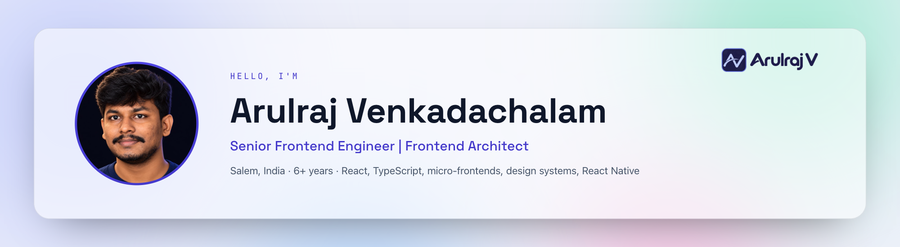
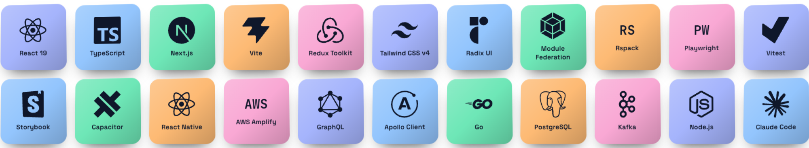

  <picture>
    <source media="(prefers-color-scheme: dark)" srcset="assets/banner-dark.png">
    
  </picture>

  <picture>
    <source media="(prefers-color-scheme: dark)" srcset="assets/typing-dark.svg">
    
  </picture>

  <picture>
    <source media="(prefers-color-scheme: dark)" srcset="assets/status-dark.svg">
    
  </picture>

  
  
  
  

<picture>
  <source media="(prefers-color-scheme: dark)" srcset="assets/divider-about-dark.png">
  
</picture>

Senior Frontend Engineer with 6+ years designing and delivering scalable web and mobile platforms, leading frontend architecture across 16 frontend applications and modules at The Reward Store. Architected a Module Federation platform of 9 micro-frontends integrated into 4 host applications, a multi-gateway checkout and a 76-component multi-brand design system. Owns release engineering, testing standards and production reliability.

<picture>
  <source media="(prefers-color-scheme: dark)" srcset="assets/divider-strengths-dark.png">
  
</picture>

<table>
  <tr>
    <td>▸ &nbsp;Frontend Architecture &amp; Micro-Frontends</td>
    <td>▸ &nbsp;Payment &amp; Checkout Flows</td>
  </tr>
  <tr>
    <td>▸ &nbsp;Design Systems &amp; Multi-brand Theming</td>
    <td>▸ &nbsp;Testing &amp; Accessibility</td>
  </tr>
  <tr>
    <td>▸ &nbsp;Release &amp; Production Ownership</td>
    <td>▸ &nbsp;Performance &amp; Bundle Budgets</td>
  </tr>
  <tr>
    <td>▸ &nbsp;Mobile Apps &amp; SDKs</td>
    <td>▸ &nbsp;Technical Leadership &amp; Mentoring</td>
  </tr>
</table>

<picture>
  <source media="(prefers-color-scheme: dark)" srcset="assets/divider-stack-dark.png">
  
</picture>

  <picture>
    <source media="(prefers-color-scheme: dark)" srcset="assets/tiles-dark.png">
    
  </picture>

- **Frontend:** React 19, TypeScript, JavaScript, Next.js, Vite, React Router, Redux Toolkit / RTK Query, Apollo Client, Tailwind CSS v4, Radix UI, SCSS / Sass, Styled Components, CSS Modules, Formik + Yup, React Hook Form + Zod
- **Architecture & Build:** Micro-frontends, Module Federation, Rspack / Webpack (splitChunks, code splitting, Brotli bundle budgets), design systems, pnpm / Turborepo monorepos, Changesets
- **Payments & APIs:** Razorpay, Cashfree, Zaakpay, points and wallet checkout; REST, OpenAPI (generated types), GraphQL (Apollo, AWS AppSync), SSE, OAuth / SSO / OTP
- **Testing & Accessibility:** Playwright, @axe-core/playwright, Vitest, Jest, React Testing Library, Storybook, CI coverage gates
- **Mobile, Cloud & Delivery:** Capacitor, React Native, App Store / Google Play releases, SDKs for iOS / Android / Flutter; AWS Amplify, GitLab CI, Bitbucket Pipelines, feature flags, HyperDX / ClickHouse
- **Backend & Tools:** Go / gRPC, PostgreSQL, Kafka (working knowledge); Claude Code, Cursor

<picture>
  <source media="(prefers-color-scheme: dark)" srcset="assets/divider-experience-dark.png">
  
</picture>

### Senior Software Engineer, Frontend · The Reward Store
Global Rewards Platform (Vananam Rewards Private Limited) · <b>Jan 2025 – Present</b>

<table>
  <tr>
    <td align="center"><b>16</b> frontend apps and modules</td>
    <td align="center"><b>9 + 4</b> micro-frontends and host apps</td>
    <td align="center"><b>76</b> design-system components</td>
    <td align="center"><b>~460</b> Playwright tests with axe checks</td>
  </tr>
</table>

Leads frontend architecture for three products, Storefront (Rewards), Rekyndl (Loyalty) and Applaud IQ (Employee Recognition), plus the Client Panel and Admin Panel: 16 frontend applications and modules (9 micro-frontends, 4 hosts, 3 standalone apps). Built the Rekyndl and Applaud IQ apps from scratch; started as the only senior frontend engineer and now also mentors a junior developer.

- **Micro-frontend architecture:** Built the 9 Storefront micro-frontends in React and TypeScript on Rspack Module Federation and composed them into the 4 hosts (Storefront, Rekyndl, Applaud IQ, Client Panel) with shared singleton dependencies, so features are built once and reused.
- **Payments & checkout:** Built one checkout for six categories (gift cards, recharge, bills, flights, merchandise, experiences) with a per-customer payment gateway resolver (points, wallet, Razorpay, Cashfree, Zaakpay), status polling, failure / dismissal / refund handling and a shared error catalog.
- **Release isolation & performance:** Made each remote independently releasable with per-remote Amplify rollback, federation retry, route-level error boundaries, stale-chunk recovery and release detection; targeted splitChunks and Brotli bundle budgets fail CI when a build exceeds its budget.
- **Design system:** Designed and published @therewardstore/*, used by all 16 apps and modules: 76 accessible Radix + Tailwind v4 components with multi-brand light/dark theming and runtime white-labelling; 80 versions in 11 weeks, replacing two legacy UI kits.
- **Testing & accessibility:** Established ~460 Playwright tests with @axe-core accessibility checks against Storybook and a 95% changed-file coverage gate on Vitest + React Testing Library suites, with CI gates that block detected test failures and accessibility violations.
- **Mobile & SDKs:** Published the Storefront and Applaud IQ apps on a remote-URL Capacitor shell, so web deploys reach installed apps without a store review cycle; shipped the Applaud IQ embed SDK for 6 runtimes on one bridge protocol.
- **Production & rollout:** Owns AWS Amplify deployments, staging / production and store releases; per-customer feature flags gate which remotes load and stage rollouts. Diagnosed a Capacitor session-cookie loss through HyperDX / ClickHouse traces and fixed it with a dev API proxy.
- **Architecture leadership:** Owns the frontend platform decisions all 16 apps and modules build on (Module Federation conventions, shared packages), recorded in 45+ architecture decision records; sets coding standards, reviews PRs and built the create-app scaffolding CLI.
- **Backend contributions (AI-assisted):** Over ~6 months, contributed Go / gRPC routes, protobuf contracts, handlers and PostgreSQL migrations to 5 services (gateway, notifications, employee, rewards, loyalty-engine) and Kafka consumers; reviewed and tested every change.

<b>Software Engineer · Ripple Street India Private Limited</b> &nbsp;B2H Marketing Platform · Jul 2023 – Jan 2025

 

React web platform on Module Federation micro-frontends with AWS Amplify and AppSync GraphQL, plus iOS and Android React Native apps.

- **Apollo Client & GraphQL:** Kept lists current without refetching using cache.modify, keyFields and optimisticResponse (rollback with an error toast on failure); regenerated TypeScript types from the AppSync schema with Amplify codegen.
- Shipped the iOS and Android React Native apps to both stores.
- Owned core features and removed redundant code, cutting bundle size by 20%.

<b>Senior Software Engineer · Squash Apps</b> &nbsp;FinTech &amp; Workplace Solutions · Apr 2022 – Jul 2023

 

- Led a team of 2 engineers delivering the Payfiniti payment apps for web, Android and iOS on time.
- Built an offline-capable office desk-booking app for Android and iOS with React Native CLI.
- Independently managed two client projects, one for a US client and one for an Australian client, owning requirements discussions, development coordination and delivery across time zones.

<b>Frontend Developer · Zita.ai</b> &nbsp;AI-Powered Recruitment Platform · Oct 2021 – Mar 2022

 

- Owned the entire frontend of an AI resume-evaluation platform in React.js, from UI/UX to production.
- Streamlined the evaluation flow, cutting candidate selection time by 50% versus the manual process.

<b>Frontend Developer · ShopUp</b> &nbsp;Retailer E-Commerce Platform · May 2020 – Oct 2021

 

- Built a UI component npm library standardising UI across projects (+30% developer productivity).
- Designed and implemented the product-management interface for the retailer catalogue.

<picture>
  <source media="(prefers-color-scheme: dark)" srcset="assets/divider-education-dark.png">
  
</picture>

- **B.E. — Computer Science Engineering**, Thiagarajar College of Engineering, Madurai · 2017 – 2020 · CGPA 7.03
- **Diploma — Electronics & Communication Engineering**, Thiagarajar Polytechnic, Salem · 2015 – 2017 · 89%

**Languages:** Tamil (native) · English (professional working proficiency)

  Portfolio: <a href="https://arulraj1997.netlify.app">arulraj1997.netlify.app</a> · built with Next.js and React Three Fiber · graphics in this README are generated by <code>scripts/make-assets.mjs</code>

